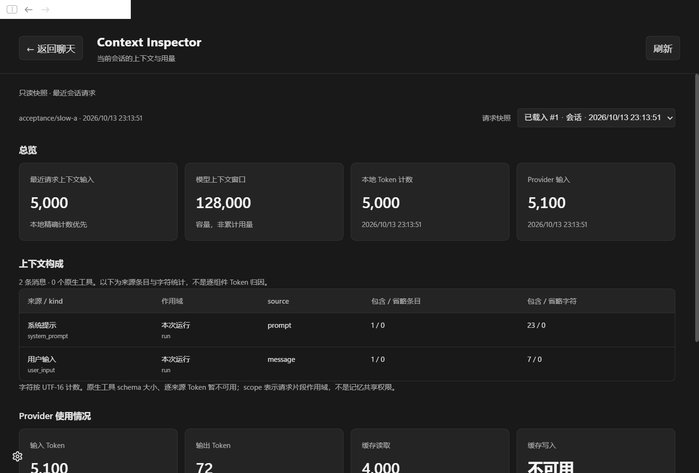
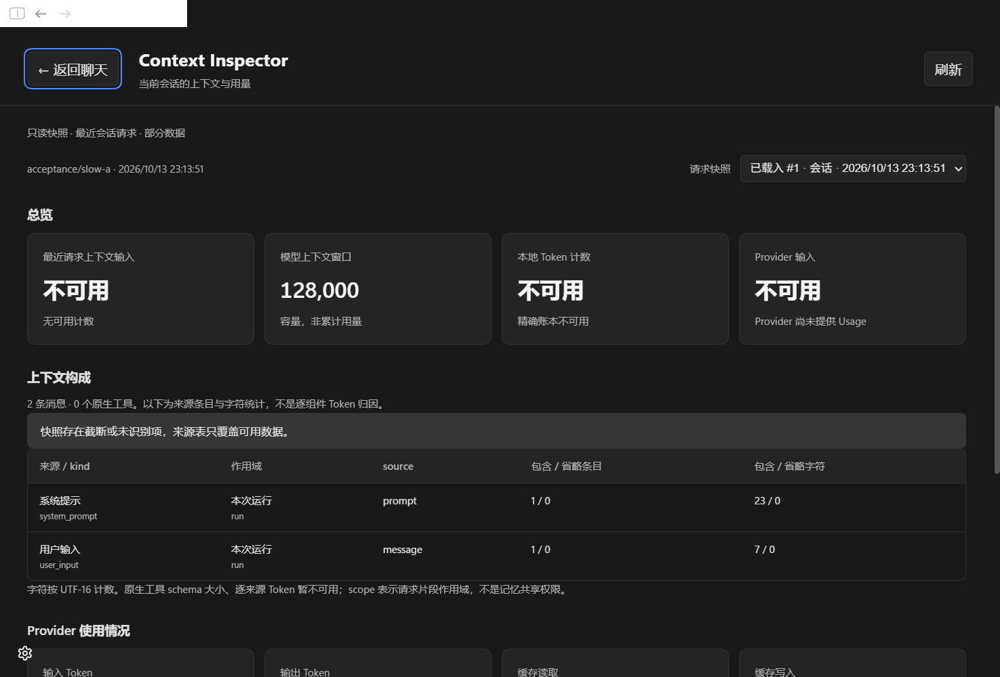
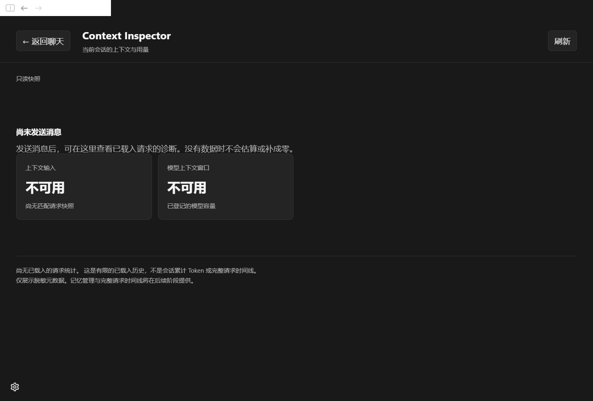
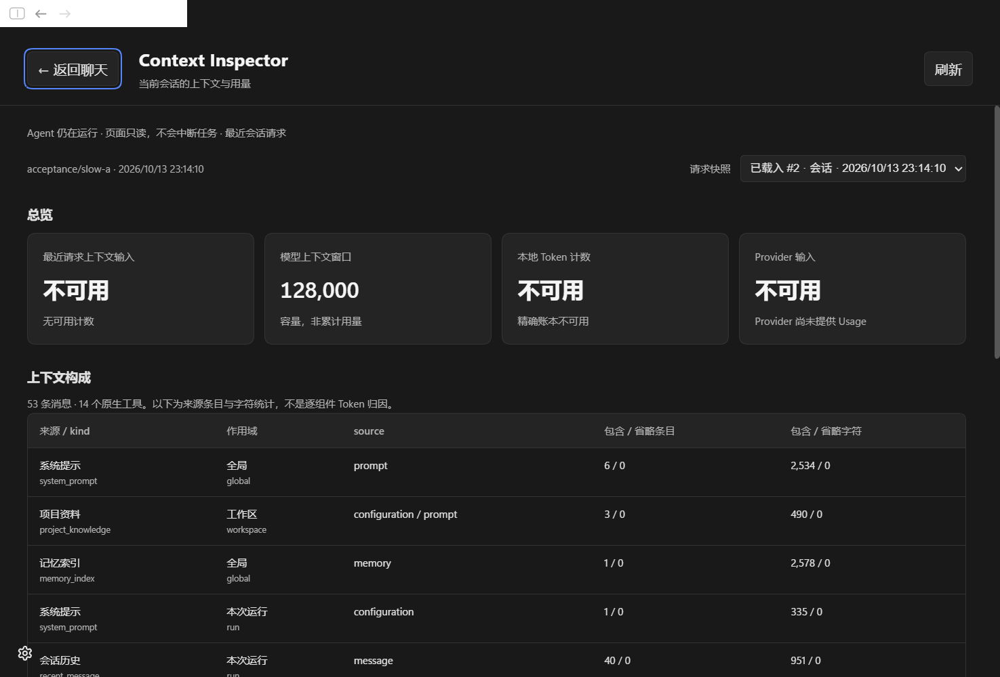

# CMv2-P0B：Context Inspector 基础版实施报告

日期：2026-10-13。范围：在 P0A 基础上集成桌面 Context Inspector；包含 P0A 尚未提交的工作区改动。不实施 P1 记忆隔离、P2 Prompt/工具优化或完整 P4 时间线。

## 已实现

- 输入框原有圆环改为原生 button，保留 SVG、颜色、尺寸、悬停用量与原计数算法；支持鼠标、Enter/Space 和焦点反馈。[入口](../../packages/app/src/renderer/composer/context-usage-indicator.tsx)。
- 独立页面采用现有 `AppRoute` 的 `section: 'context'`，不新增路由框架。聊天 DOM 始终挂载，后台 inert/隐藏绘制；返回聊天恢复圆环焦点，不创建会话、不清空草稿、不改 Agent 生命周期。[导航](../../packages/app/src/renderer/app-shell/use-app-controller.ts)、[布局](../../packages/app/src/renderer/app-shell/app-view.tsx)。
- 展示最近会话请求或用户选择的已载入历史快照：模型、时间、输入与窗口、本地精确账本、Provider Usage、来源条目、kind/scope/source 类别、字符与包含/省略统计。[页面](../../packages/app/src/renderer/context-inspector/page.tsx)、[适配](../../packages/app/src/renderer/context-inspector/model.ts)。
- Provider 输入、输出、缓存读取/写入/未命中与推理子集独立展示；未知显示不可用，零只来自实际的已知计数。字符缺失使用 unavailable 标志，不伪装为零；不按字符比例分摊 Token。
- 新会话、无 Trace、运行中、读取失败、partial、模型窗口未知、切会话、历史模型不匹配均有明确状态。选择历史或辅助请求时标明不代表当前窗口占用；不显示会话累计 Token。

## 实际数据与接口

| 边界 | 实现 |
| --- | --- |
| Context | [buildContextTrace](../../packages/context/src/context-trace.ts)：复用已有快照，不读取正文或重复 tokenization；仅增加有限 `sourceKinds` 类别和字符不可用标记 |
| Runner 公共接口 | [AgentRunner.inspectContext](../../packages/runner/src/runner.ts)、[ContextInspectionStore](../../packages/runner/src/context-inspection.ts)：同步、只读、仅内存 |
| 历史数据来源 | 现有 ExecutionLog 正常写入／聊天回放时附带生成脱敏投影。Inspector 查询不调用 `replay`，不读取 Session 原文，不发起额外日志扫描。[观察入口](../../packages/runner/src/execution-log.ts) |
| 活动数据来源 | Runner 已持有的 RunContext 请求快照；本轮结束解除引用，shutdown 清空。活动页每两秒读取已有元数据，不生成新采样或模型请求 |
| Main | `GET /sessions/:sessionId/context`，复用 Local App API bearer 访问边界；验证当前活动 SessionIndex 或已被 Runtime 接受的活动会话，再获取对应投影。[接口](../../packages/app/src/main/local-app-api/context-inspector-routes.ts) |
| Shared | [context-inspector-contracts](../../packages/app/src/shared/context-inspector-contracts.ts) 复用 Runner 公共类型；路径 suffix 由 [route catalog](../../packages/app/src/shared/local-app-api-routes.ts) 统一定义 |
| Renderer | [client](../../packages/app/src/renderer/api/context-inspector.ts) 验证响应版本与 sessionId；页面退出／换会话时 abort 与 disposed guard，选择函数再次拒绝跨会话数据 |

`ContextInspection` 返回 version、sessionId、`coverage: loaded_history`、requests、retainedRequests、truncated、active。每个请求含关联 id、ordinal、模型、合法时间、可用窗口、runState、是否会话请求与脱敏 Trace；不含原始 Prompt、source id/path/hash、资源名称、记忆正文或工具输出。

内存最多保留 128 个 run 的安全投影，每个 run 受已有 64 请求快照上限约束；单次响应最多 32 请求。主窗口默认选择当前模型的最近会话请求，回退历史模型时显式标注历史。已载入请求数量和含 Usage 的请求数量只描述当前覆盖，不能充当 all-time 成本或缓存命中率。

## 隐私审查

P0A 的既有 `systemPromptProjection` 原文持久路径仍属于原聊天披露／日志功能。**新页面完全绕开该字段和 raw replay 入口**：只消费 `inspectContext` 的最小投影；查询不会为了补全 Inspector 历史而扫描原文文件，也没有新增诊断磁盘存储。[隐私测试](../../packages/runner/src/context-inspection.test.ts) 用会抛异常的 raw-field getters 证明投影没有访问完整 Prompt、输入、回复、工具或记忆字段；[Main 测试](../../packages/app/src/main/local-app-api/context-inspector-routes.test.ts) 证明未知会话被拒绝，且 `replay/sessionManager.read` 没有被调用。

已有聊天历史加载可能本来就读取包含原文的日志；这不等同于 Inspector 增加原文读取。内存投影不持有原文对象，返回响应再 clone，调用方不能修改缓存。原文日志治理仍是后续独立范围，不能声称整个产品日志已经脱敏。

边界取舍：重启后、尚未正常载入的历史或被内存上限淘汰的诊断会显示不可用；本阶段不通过新的持久索引或 raw replay 弥补，以满足隐私和零新增默认磁盘存储约束。

## 验证与视觉证据

1. 最终定向回归 12 文件、81 tests 全部通过，覆盖 ExecutionLog、圆环旧口径、Trace、API 归属、页面空态、导航、适配、追加式前缀以及六场景 Runner 基线；Trace 包含 5 个隐私／缺失／关联断言。
2. `pnpm run verify:core`：5 文件、73 tests 通过，含仓库卫生与全 workspace TypeScript。`pnpm --filter @littlesheep/app run typecheck` 通过，覆盖 Main 与 Renderer。未执行完整打包／外部 Provider 验收。
3. P0A 六场景实际请求组装继续通过，规范化非流式 body 大小保持 22,663 / 23,058 / 22,930 / 23,794 / 23,326 / 24,674 bytes，未修改原有 Prompt、工具目录、记忆共享或缓存前缀。最终联跑 Trace 单次均值约 5.6–7.4 µs，更高宿主负载时曾为 8–19 µs；不能据此声称相对 P0A 的性能收益或严格零变化。没有重复 tokenization 或默认磁盘 IO 是代码边界事实。
4. `node scripts/verify-context-inspector.mjs` 启动隔离数据根的真实 Electron 44.4.5 与本地 HTTP Provider。验证了 13 项交互／隐私条件：新会话草稿保留、不创建会话、双账本区分、缺失缓存字段、无敏感正文、API 无 raw projection、历史草稿、精确滚动位置、返回焦点、原生 Enter/Escape、切会话无 Usage 串台、运行中导航保留任务与草稿、未知会话 404。[可复核结果](context-inspector-evidence/result.json)。
5. 实机首次暴露浮动聊天任务栏遮挡标题及焦点恢复过早，均修复后重跑。键盘 CDP 使用仓库既有 native key 参数和 Enter 字符事件；没有用手工调用点击 callback 代替键盘验收。

以下为真实 Electron 截图。5000/5100、128000 等是显式隔离 UI 夹具，用于证明双账本和缺失字段的展示，不是外部模型实际计费或 tokenizer 校准结果。运行中图来自真实 Runner/本地 HTTP 请求。

## P1 / P4 接口建议与未实现事项

- **P1**：请求 segment scope 与 Memory atom/resource 的实际共享权限继续分开。新增记忆管理能力时必须通过 Main 的受控工具／所有权接口，不从 Inspector 的 scope 文本授予权限。返回值宜使用有限 scope/authority/disclosure 枚举与 opaque identity，不携带私有路径或正文。当前 global/project/workspace/session 共享语义未改。
- **P4**：在授权的安全索引上增量提供 request cursor、覆盖范围、生命周期、物理 attempt 与 compaction operation 身份；明确区分单次请求、当前模型窗口与累计用量。基础版请求选择器只是有限已载入快照选择，不是完整时间线。
- 逐组件精确 Token 仍不可用；原生工具 schema 大小仍不可从旧 Trace 恢复。后续可增加纯数值、按需计数和明确版本，不能回退到按字符比例制造“精确”值。
- 既有原文日志风险另行治理；本页不读取、不新增持久化这些字段。页面显示的可见性覆盖应继续保留 unavailable/partial，不能以历史范围缺口为理由绕过隐私边界。

P0B 到此停止。发布交付按用户要求提交 P0A/P0B 全部变更并推送 main，不继续实施 P1/P2。
